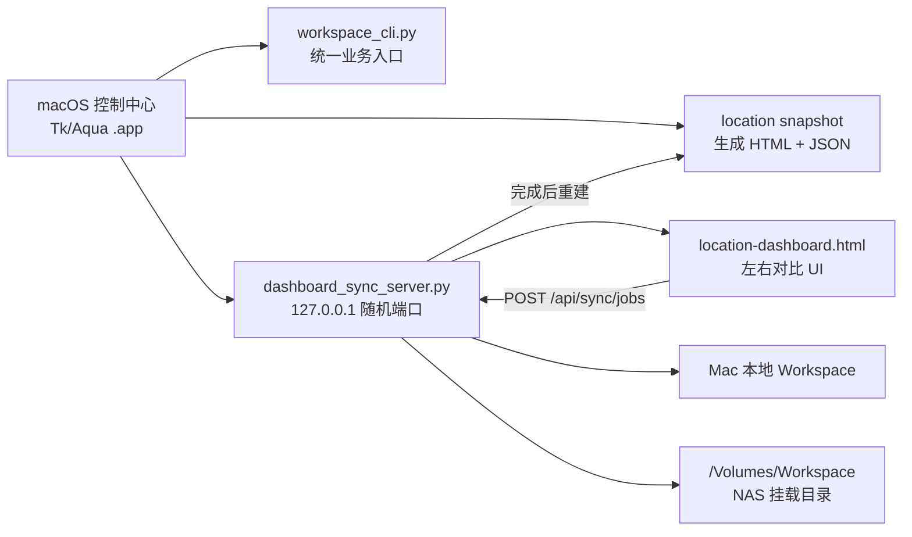

# Workspace OS 2.0 控制中心与网页版最终技术交接

> 交接对象：MacBook 上的 Codex / 工程师  
> 基准版本：Workspace OS 2.0.0  
> 文档日期：2026-08-02  
> Windows 主开发目录：`D:\CodeX\Workspace OS 2.0`  
> NAS 主共享：`smb://192.168.1.9/Workspace`  
> macOS 默认挂载：`/Volumes/Workspace`

## 1. 交接目标

在 MacBook 上实现并验证与 Windows 控制中心等价的 Workspace OS 2.0，重点保证以下闭环：

1. 图形控制中心能配置本地 Workspace 和 NAS 挂载目录。
2. 控制中心所有业务按钮调用同一套 Python CLI，不复制业务逻辑。
3. “打开网页版”先生成电脑/NAS 文件位置快照，再启动本机 HTTP 服务。
4. 网页以左右双栏树展示本地和 NAS 文件夹/文件差异。
5. 中间“状态 / 操作”栏直接提供上传 NAS、下载本地或冲突方向选择。
6. 每次用户操作只产生一个后台任务卡；任务显示实际文件数、字节数和百分比。
7. 文件夹支持递归同步和空目录；普通同步不覆盖，覆盖操作必须确认。
8. 任务完成后刷新一次最新差异；历史任务不得造成循环刷新。

## 2. 总体架构



设计原则：

- 控制中心是编排层，不直接实现扫描、索引、快照或安全审计。
- CLI 是业务事实来源；Windows 和 macOS 传入等价参数。
- 网页是展示与任务控制层，不能直接访问任意文件系统路径。
- 同步服务只绑定启动时明确配置的本地根目录和 NAS 根目录。
- 所有相对路径必须拒绝绝对路径和 `..`；链接、junction、reparse point 不跟随。
- 普通同步不覆盖已有文件，不提供自动删除和镜像删除。

## 3. 关键源码与职责

| 文件 | 职责 |
|---|---|
| `scripts/windows/WorkspaceOS-ControlCenter-WPF.ps1` | Windows 控制中心功能与参数基准 |
| `scripts/macos/workspace_os_control_center.py` | macOS Tk/Aqua 控制中心 |
| `scripts/python/workspace_cli.py` | 所有业务命令的统一 CLI |
| `scripts/python/location_snapshot.py` | 扫描本地/NAS，生成状态、HTML 与 JSON |
| `templates/location-dashboard.html` | NEXUS 网页最终 UI、目录树、任务中心和前端轮询 |
| `scripts/python/dashboard_sync_server.py` | 本机 HTTP API、后台复制、进度和完成后快照刷新 |
| `scripts/python/macos_package.py` | macOS 便携 `.app` ZIP、清单和 SHA-256 打包验证 |
| `scripts/macos/build-standalone-app.sh` | 在真实 Mac 上用 PyInstaller 生成独立 `.app` |
| `tests/test_workspace_os.py` | 功能、同步安全、包完整性和回归测试 |

不要在 Mac 上另写一套同步或快照算法。应直接复用这些 Python 文件。

## 4. 控制中心功能基准

### 4.1 界面入口

macOS 控制中心必须包含以下 16 个入口，与 Windows 版语义一致：

| 分区 | 按钮 | CLI / 行为 |
|---|---|---|
| 开始使用 | 初始化工作区 | `init --path <workspace>` |
| 开始使用 | 整理收件箱 | `scan-inbox --workspace <workspace>`，仅预览 |
| 开始使用 | 执行收件箱整理 | `scan-inbox --workspace <workspace> --apply`，执行前确认 |
| 开始使用 | 打开网页版 | 生成位置快照并启动本地同步服务 |
| 查找保护 | 搜索资料 | `search <query> --database <db> --limit 50` |
| 查找保护 | 更新搜索索引 | `search-maintain --workspace ... --content` |
| 查找保护 | 快照预览 | `snapshot --workspace ... --destination ... --exclude-rebuildable-cache` |
| 查找保护 | 创建快照 | 上述参数增加 `--apply`，执行前确认 |
| 维护恢复 | 系统健康检查 | `doctor --workspace ... --snapshots ... --nas ...` |
| 维护恢复 | 安全检查 | `security-audit --workspace ...` |
| 维护恢复 | 提醒与告警 | `alerts --workspace ...` |
| 维护恢复 | 恢复状态 | `recovery-readiness --workspace ... --snapshots ...` |
| 维护恢复 | 恢复到新文件夹 | `restore <snapshot> --destination <new-dir> --apply` |
| 维护恢复 | 打开工作区 | macOS 使用 `open <workspace>` |
| 日志区 | NAS 设置 | 保存 `/Volumes/...` 挂载路径 |
| 日志区 | 使用说明 | `open docs/使用说明与功能介绍.md` |

### 4.2 macOS 设置

设置文件：

`~/Library/Application Support/WorkspaceOS/control-center-settings.json`

结构：

```json
{
  "workspace_path": "/Users/<user>/Workspace",
  "nas_path": "/Volumes/Workspace"
}
```

不得把 NAS 账号、密码、Token、Cookie 或 SMB 凭据写入该文件。NAS 登录由 Finder / macOS 钥匙串负责。

### 4.3 异步执行

- CLI 使用后台线程运行，避免阻塞 GUI。
- 子进程命令必须使用参数数组，不拼接 Shell 字符串。
- stdout、stderr 使用 UTF-8，错误字符采用替换策略，避免日志线程崩溃。
- 任务运行期间禁用动作按钮；完成后恢复。
- 失败时同时写活动日志并显示用户可理解的弹窗。
- 关闭控制中心时终止由本实例启动的网页后台服务。

## 5. “打开网页版”实现流程

macOS 控制中心执行：

```text
workspace_cli.py locations
  --computer ~/Workspace
  --nas /Volumes/Workspace
  --refresh-nas
  --refresh-nas-capacity
  --output ~/Workspace/08_Indexes/file-locations.html
```

完成后：

1. 用本机 socket 申请一个空闲随机端口。
2. 启动 `dashboard_sync_server.py`：

```text
python3 dashboard_sync_server.py
  --computer ~/Workspace
  --nas /Volumes/Workspace
  --dashboard ~/Workspace/08_Indexes/file-locations.html
  --port <random-port>
```

3. 轮询 `http://127.0.0.1:<port>/api/health`。
4. 健康后打开 `http://127.0.0.1:<port>/dashboard#compare`。
5. 启动失败时只打开本地 HTML，并明确提示该模式只读、不能同步。

重要：网页上传/下载只能在 `http://127.0.0.1` 服务模式下启用；直接用 `file://` 打开必须保持只读。

## 6. 文件状态模型

`location_snapshot.py` 为每个相对路径生成以下状态：

| 状态 | 含义 | 中间栏动作 |
|---|---|---|
| `COMPUTER_ONLY` | 只在电脑存在 | 上传 NAS |
| `NAS_ONLY` | 只在 NAS 存在 | 下载本地 |
| `BOTH_SAME` | 两边内容一致 | 无同步动作 |
| `CONFLICT` | 两边都有但大小或内容摘要不同 | 上传 NAS / 下载本地，由用户选方向 |
| `BOTH_UNVERIFIED` | 两边都有但未完成强校验 | 上传 NAS / 下载本地，由用户选方向 |

文件比较优先使用存在性和大小；小于哈希阈值的双侧文件计算 SHA-256。较大文件或缓存模式不得误报为一致。

目录记录独立保存双侧存在性。网页递归汇总：

- `node.toNas`：本目录或任一后代存在 `COMPUTER_ONLY`。
- `node.toComputer`：本目录或任一后代存在 `NAS_ONLY`。
- `directDiff`：当前目录存在性不同或当前层文件有差异。
- `childDiff`：当前层无直接差异，但后代存在差异。

递归必须遍历全部子节点，不能使用会在第一个 `true` 后短路的 `.some(markDirectoryDiff)`。

## 7. 网页最终界面

### 7.1 左右双栏

布局顺序固定为：

```text
选择 | 电脑本地 | 状态 / 操作 | NAS
```

- 文件夹和文件整合在同一目录树中。
- 目录在文件之前显示。
- 无差异目录也显示，因为差异可能位于后代。
- 差异目录使用不同边框和背景色。
- 每个可操作目录/文件保留复选框。
- 选中父目录时，当前已渲染的后代目录和文件同步选中。
- 中间栏直接显示单项操作按钮，顶部操作栏用于批量选择。

### 7.2 大目录性能

最终版本采用懒加载目录树：

- 初次只渲染顶层和默认展开的一层。
- `<details>` 展开时调用 `renderCompareChildren()` 生成下一级。
- `compareTreeIndex` 保存相对路径到节点对象的映射。
- “展开全部”分批处理，每批 80 个节点并让出事件循环。
- “折叠全部”只关闭当前已渲染的 `<details>`。

在约 37,000 个文件的当前 Workspace 上，首屏 DOM 从约 5,557 行降到约 79 行。Mac 版不得退回一次性递归生成全部 DOM 的实现。

### 7.3 筛选

- 默认“只看差异”。
- 支持全部、仅电脑、仅 NAS、冲突、两边一致。
- 支持关键词和一级目录筛选。
- 文件列表分页显示，当前每批 260 项。

## 8. 同步 API 契约

服务仅监听 `127.0.0.1`。

### 8.1 健康检查

```http
GET /api/health
```

返回：

```json
{"ok": true}
```

### 8.2 创建任务

```http
POST /api/sync/jobs
Content-Type: application/json
```

示例：

```json
{
  "direction": "to_nas",
  "relatives": ["01_Projects/A/file.txt"],
  "prefixes": ["01_Projects/B"],
  "mode": "safe"
}
```

字段：

- `direction`：`to_nas` 或 `to_computer`。
- `relatives`：明确选择的文件相对路径。
- `prefixes`：选择的目录相对路径。
- `mode`：`safe` 或 `overwrite`。

服务端会去重目录前缀；如果同时选择父目录、子目录和其中的文件，只保留覆盖范围最外层的目录，避免重复任务。

### 8.3 查询任务

```http
GET /api/sync/jobs
GET /api/sync/jobs/<job-id>
```

核心返回字段：

```json
{
  "id": "...",
  "direction": "to_nas",
  "mode": "safe",
  "status": "running",
  "total_files": 2,
  "completed_files": 1,
  "total_bytes": 10485760,
  "copied_bytes": 8388608,
  "current": "relative/path/file.bin",
  "errors": []
}
```

状态流：

```text
queued → scanning → running → completed
                              ↘ completed_with_refresh_error
```

## 9. 复制与进度算法

### 9.1 普通同步

- `safe` 模式只把源侧存在、目标侧缺失的文件加入任务清单。
- 目标已有同名文件时跳过，不覆盖。
- 不删除目标独有文件。
- 文件夹递归扫描，但跳过 `.git`、`.vs`、`node_modules`、回收站、缓存和链接目录。

### 9.2 覆盖模式

- 只处理用户明确选择的文件或文件夹。
- 前端必须显示确认弹窗。
- 目标同名文件可替换，但不删除其他目标文件。
- 不允许把“覆盖”解释为整盘镜像或删除同步。

### 9.3 实时进度

最终版本使用 8 MB 分块读取和写入：

1. 写入随机命名的 `.partial` 临时文件。
2. 每成功写入一块，线程安全增加 `copied_bytes`。
3. 完整写入后复制时间元数据并检查大小。
4. 普通模式再次确认源文件复制期间未变化、目标没有并发出现。
5. 用 `os.replace()` 原子提交目标文件。
6. 成功后才增加 `completed_files`。
7. 失败时回滚本文件已报告的字节，并删除 `.partial`。

不得仅依据“目标文件存在且尺寸相同”推测任务完成；这种做法会把预先存在的冲突文件误报为 100%。

### 9.4 空目录

纯空文件夹没有字节可用于百分比，因此每个被选择的纯空目录作为一个完成单位：

```text
total_files = 1
completed_files = 1
total_bytes = 0
percent = 100%
```

含文件的目录按实际待复制文件计数，同时保留所有嵌套空目录。

## 10. 前端任务中心

- 一次点击只创建一个 job ID，并显示一张任务卡。
- 文件夹内有多少文件，不应拆成多少张任务卡。
- `localId` 只用于 POST 返回前的临时任务；拿到服务器 job ID 后合并同一张卡。
- 进度优先按 `copied_bytes / total_bytes`；零字节任务按文件单位计算。
- 当前文件名只显示在任务详情中。
- 成功任务显示 100%，10 秒后可自动清除状态。
- 失败任务保留并允许手动清除。
- `localStorage` 保存最近任务卡，以便刷新页面后仍可见。
- 页面刷新后只恢复 `queued/scanning/running` 的任务轮询。
- 历史 `completed` 任务绝不能再次调用 `location.reload()`，否则多个历史任务会交替造成每秒循环刷新。

任务完成后，当前 `pollSync(jobId)` 在确认服务端已重建快照后只刷新一次页面。服务端重建：

```text
build_location_snapshot(... reuse_previous_nas=False ...)
save_location_snapshot(snapshot, dashboard)
```

## 11. 安全边界

Mac 复刻时必须保留：

- 只监听回环地址，不对局域网开放同步 API。
- `_safe_relative()` 拒绝绝对路径、空路径和 `..`。
- `_under(root, candidate)` 确认源和目标始终位于配置根目录内。
- 不跟随符号链接、reparse point 或 junction。
- `08_Indexes` 不作为普通文件同步范围，避免看板自复制。
- 临时文件使用随机名称，成功后原子替换。
- 不保存 NAS 密码，不读取浏览器凭据。
- 不实现自动删除、自动双向同步和无人确认覆盖。
- 快照目标必须位于 Workspace 外部。

## 12. macOS 安装包

当前 NAS 包：

```text
/Volumes/Workspace/06_Release/Apps/macOS/
WorkspaceOS-2.0.0-Portable-macOS-040feceaad.zip
WorkspaceOS-2.0.0-Portable-macOS-040feceaad.sha256
```

SHA-256：

```text
1001d4445ca1b5833a7da3641a9987d64df51d6a01ffa581aebb9f991a1efa05
```

ZIP 内：

```text
Workspace OS.app/
  Contents/
    Info.plist
    MacOS/WorkspaceOS
    Resources/WorkspaceOS/     # 完整核心源码
README-macOS.txt
BUILD-STANDALONE.command
MACOS-MANIFEST.json
```

便携包在 Windows 生成，保留 Unix 可执行权限并完成逐文件哈希校验，但没有 Apple Developer ID 签名或公证。便携 `.app` 需要 Python 3.11+ 且包含 Tk。

在真实 Mac 上运行 `BUILD-STANDALONE.command` 可用 PyInstaller 生成不依赖外部 Python 的 `.app`。正式公开分发仍需在 Mac 上执行 Developer ID 签名和 Apple 公证。

## 13. MacBook 上的实施顺序

1. Finder 连接 `smb://192.168.1.9/Workspace`，用户自行输入凭据。
2. 验证 ZIP SHA-256，校验失败立即停止。
3. 解压并把 `Workspace OS.app` 放入 `/Applications` 或用户 Applications。
4. 检查 `python3 --version` 为 3.11+，并运行 `python3 -c 'import tkinter'`。
5. 首次启动设置本地 `~/Workspace` 和 NAS `/Volumes/Workspace`。
6. 先运行“系统健康检查”，再运行“打开网页版”。
7. 用小型临时测试目录验证：
   - 空文件夹上传显示 1/1、100%。
   - NAS 单文件下载时百分比随分块写入变化。
   - 含空子目录的文件夹完整保留结构。
   - 完成后差异消失。
   - 页面手动刷新后任务仍可见，且不循环刷新。
8. 运行全部自动测试。
9. 如需独立 `.app`，在 Mac 上执行包内 `BUILD-STANDALONE.command`。
10. 如需对外分发，再完成签名、公证和真实 Apple Silicon / Intel 验收。

## 14. 验证命令

在源码根目录：

```zsh
python3 -m py_compile \
  scripts/macos/workspace_os_control_center.py \
  scripts/python/dashboard_sync_server.py \
  scripts/python/macos_package.py

python3 -m unittest discover -s tests -v
```

当前 Windows 基线：87 项测试全部通过。

建议在 Mac 增加以下实机检查：

```zsh
python3 scripts/python/workspace_cli.py locations \
  --computer "$HOME/Workspace" \
  --nas "/Volumes/Workspace" \
  --refresh-nas \
  --output "$HOME/Workspace/08_Indexes/file-locations.html"
```

验收条件：

- GUI 16 个入口全部可点击并产生正确 CLI 参数。
- NAS 设置重启应用后仍保留。
- 网页通过随机 localhost 端口打开，而不是 `file://`。
- 左右树可以逐级展开，无差异目录仍显示。
- 差异文件和目录在中间栏出现正确方向按钮。
- 上传、下载、文件夹、空目录和冲突覆盖行为符合本文。
- 一个用户操作只显示一个任务卡。
- 进度不虚增、不超过 100%、不长期停留在 0%。
- 完成后只刷新一次，之后页面稳定。
- 没有自动删除、无人确认覆盖、凭据落盘或路径越界。

## 15. 已知限制

- 当前 Windows 环境不能完成真实 macOS GUI 启动、Apple 签名和公证验证。
- Tk/Aqua 便携版依赖外部 Python；独立版必须在 Mac 本机打包。
- 大型 NAS 首次 `--refresh-nas` 扫描可能较慢，但必须在后台线程执行，不能冻结控制中心。
- 当前后台任务只在本次同步服务进程内保存；网页刷新可恢复，服务重启后不恢复旧运行任务。
- 同步不是备份。覆盖前仍应保留可验证快照。

## 16. 可直接交给 MacBook Codex 的指令

```text
请以这份技术交接文档为唯一功能基准，在当前 MacBook 上完成 Workspace OS 2.0 macOS 控制中心和网页版验收。

先读取：
1. docs/WorkspaceOS-ControlCenter-WebDashboard-MacBook-Codex-Handoff.md
2. scripts/macos/workspace_os_control_center.py
3. scripts/python/dashboard_sync_server.py
4. templates/location-dashboard.html
5. tests/test_workspace_os.py

NAS 已挂载为 /Volumes/Workspace，本地工作区使用 ~/Workspace。不要保存或索取 NAS 密码；如未挂载，请打开 Finder“连接服务器”让我自行登录。

请按文档逐项验证 16 个控制中心入口、左右目录树、状态/操作按钮、上传 NAS、下载本地、文件夹和空目录、一个操作一张任务卡、实时百分比、刷新后恢复任务和无循环刷新。

优先修复实机兼容问题，不重写已通过测试的业务算法。不得增加自动删除、自动双向同步、无人确认覆盖或凭据保存。运行全部测试，并把实机验证结果、改动文件、安装位置、签名/公证状态和剩余限制用中文汇报。
```

